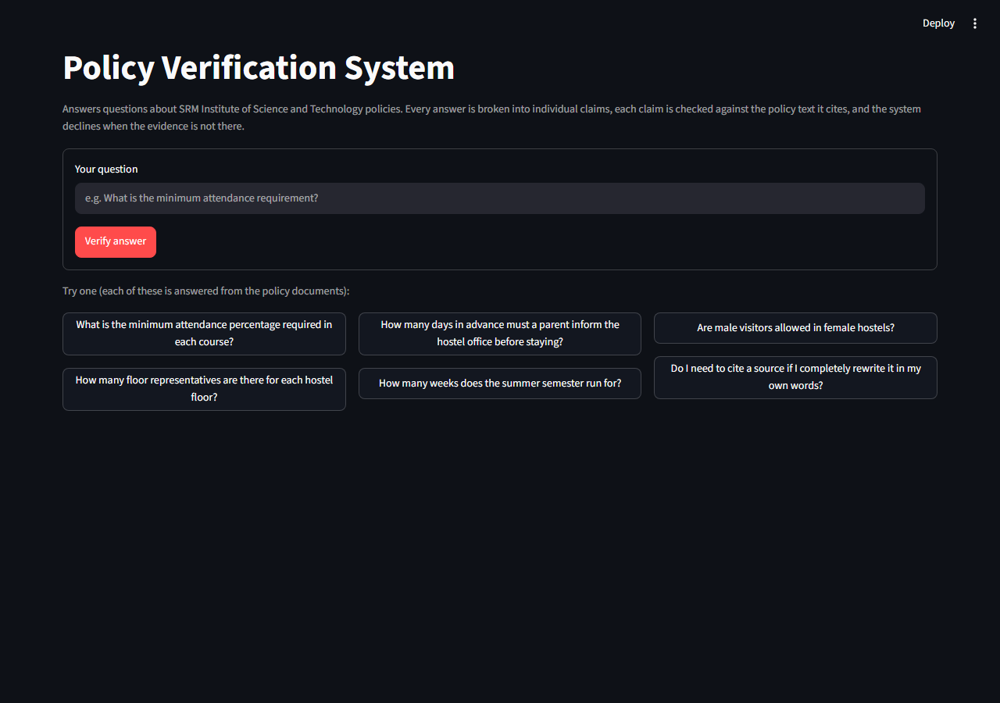
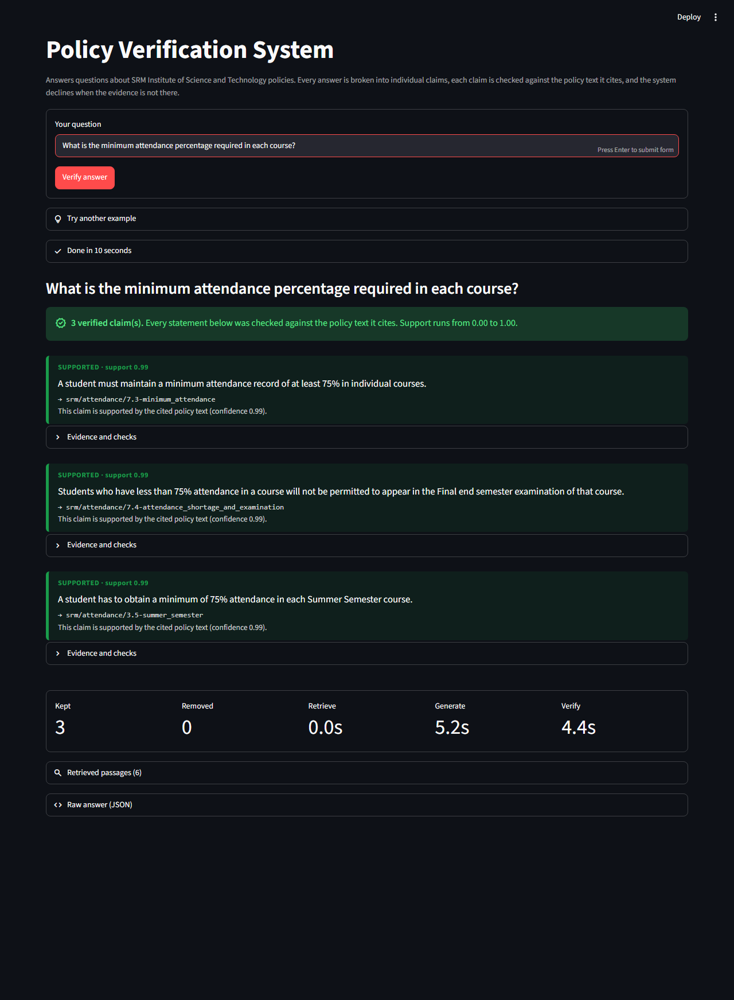
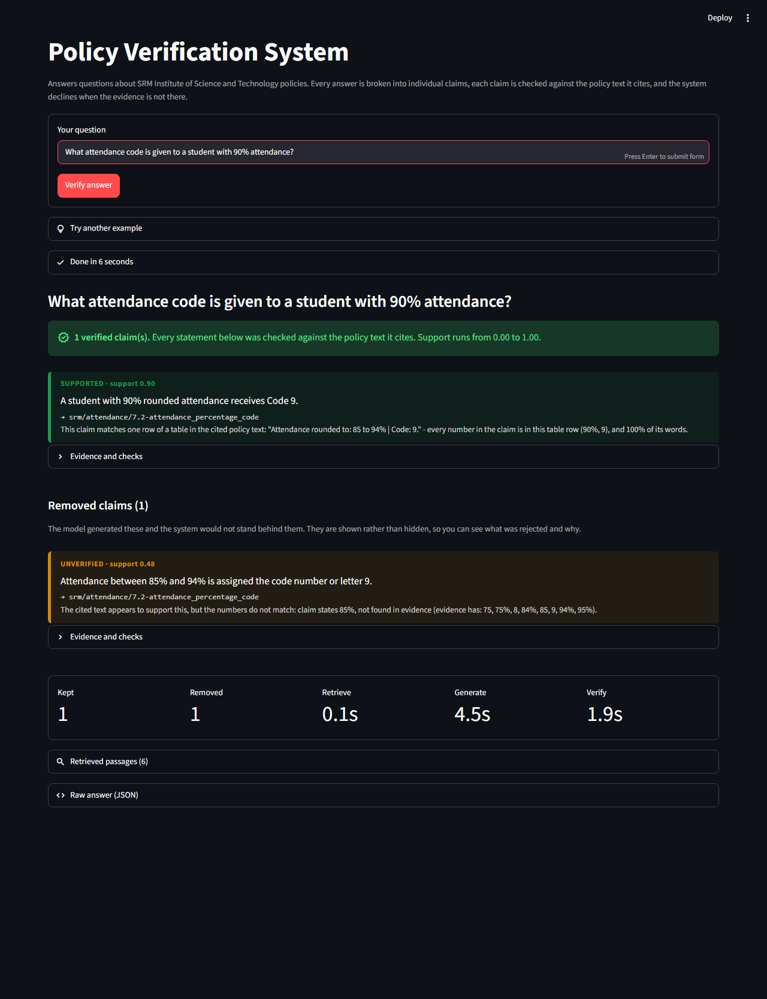
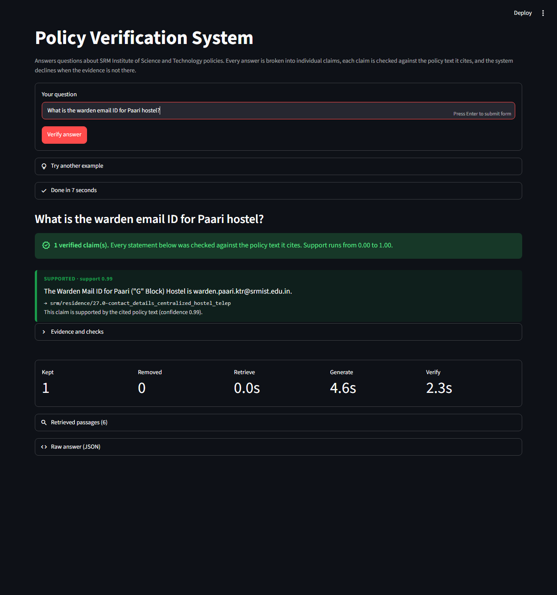
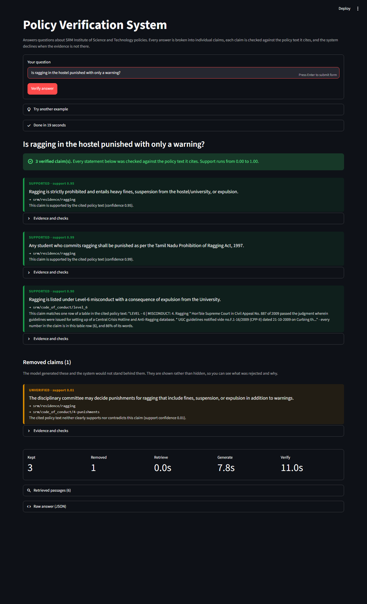
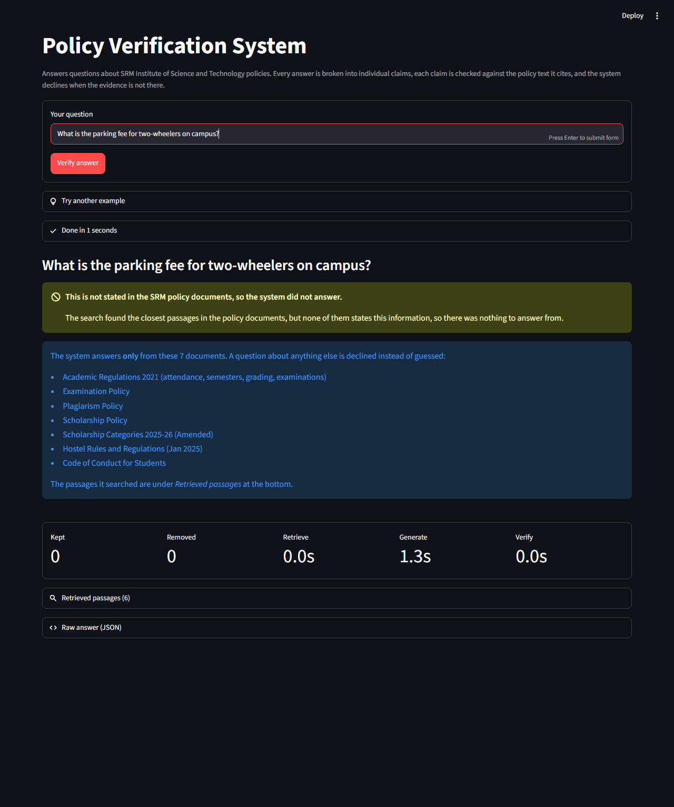
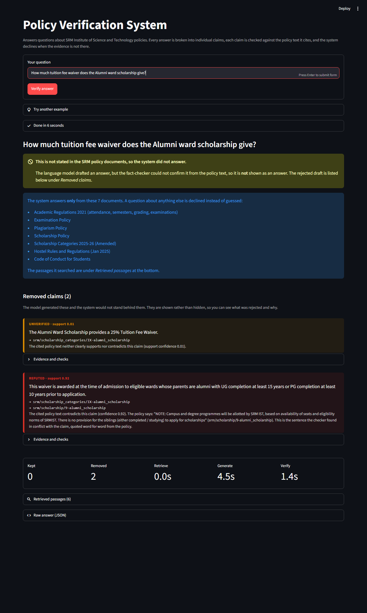
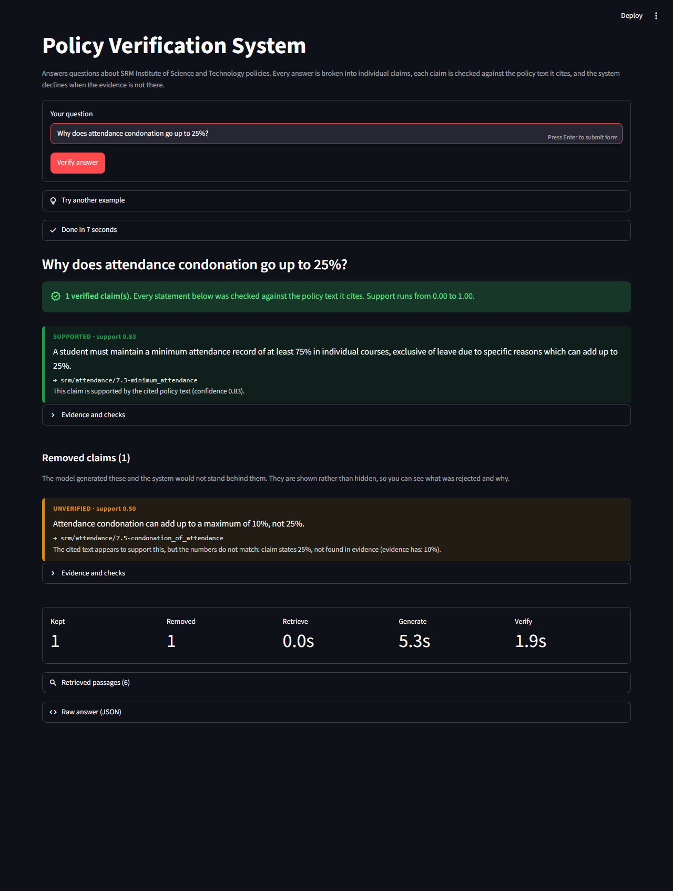
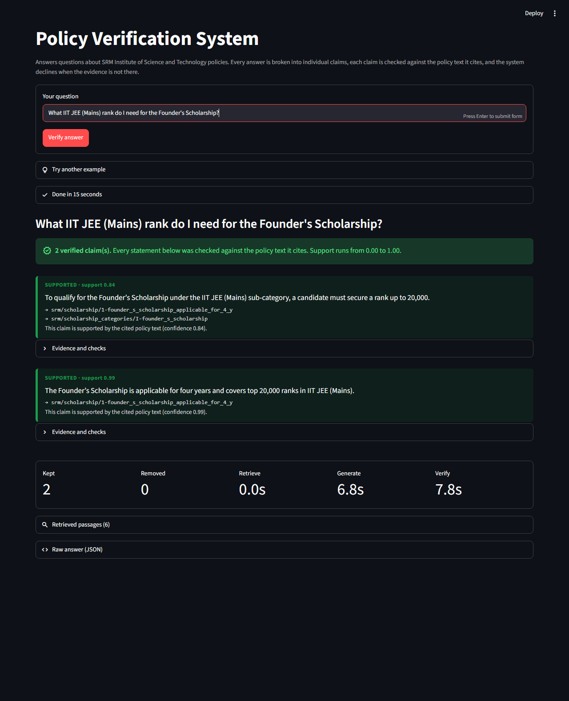
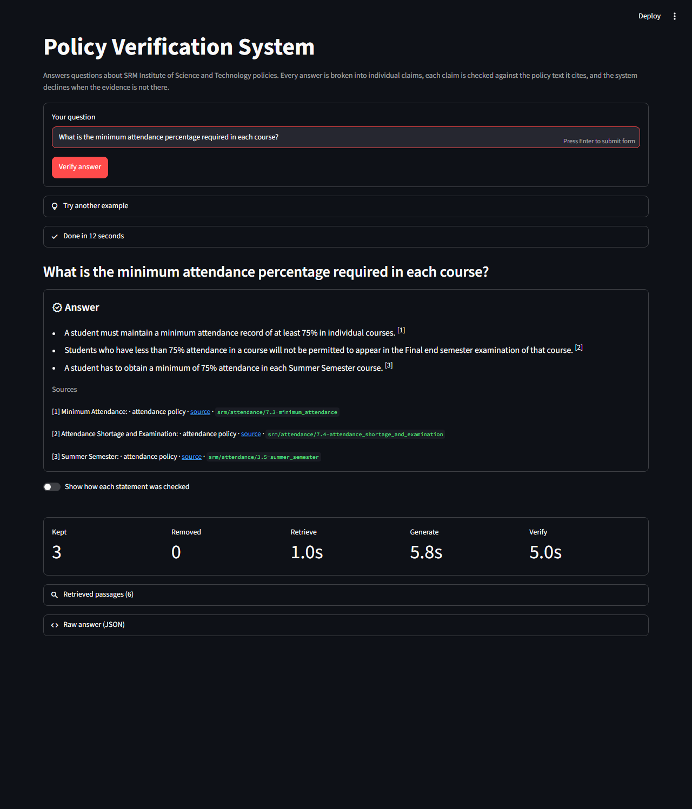

# Hallucination and Citation Verifier for Policy Question Answering

**Project report** — Policy Verification System for SRM Institute of Science and Technology policies
**Status:** final, 20 November 2026 (tested version: git tag `v2-final-test`; final test run `run-20261120-165959`)

> **Which version the results describe.** All final results were measured on **version 2**, tagged
> **`v2-final-test`** in git. A teammate later proposed further changes (PR #6): a cross-encoder
> relevance check, re-ranking, situation and list answers, composed answers, a polarity check and a
> preamble fix. **Only its interface (`app.py`) was kept**; every other part was reverted to the tested
> version, by the student's decision. So `main` = the tested version 2 plus the new interface. The
> interface changes only how an answer is shown (answer first, numbered sources, a switch to show how
> each statement was checked), not what the system answers. The PR #6 code remains in the git history.

> **How to read this report.** Every number is **measured**, and the result file it comes from is
> named beside it. Ranges in square brackets are 95% Wilson confidence intervals. Development numbers
> (measured on the tuning split, used for decisions) are kept apart from final numbers (held-out
> questions, each run once). The full day-by-day history, with every decision and every rejected
> alternative, is in [`STUDY_GUIDE.md`](STUDY_GUIDE.md) section 10; the raw data for the paper is in
> [`RESEARCH_PAPER_DATA.md`](RESEARCH_PAPER_DATA.md).
>
> **Team:** *[add names and roles]* (the split of work by phase is in `STUDY_GUIDE.md` section 9).

---

## Abstract

Students ask questions about university rules, and a language model will answer them confidently,
with a citation, even when the answer is wrong. This project builds a question-answering system over
seven SRM policy documents that **verifies every claim of its answer against the policy text it cites**
before showing it, and **declines** when nothing can be verified. An answer is split into one-fact
claims; each claim is checked by a natural-language-inference (NLI) model, a numeric guard, a
table-row check and a relevance check; unsupported claims are removed and shown as removed.

On a final test of **99 questions** written independently of the system (`qwen3.5:9b`, one run), the
system declined **15 of 16 unanswerable questions** and, read by hand, **stated no false fact as
verified** (automatic hallucination count 3.0% [1–9], all three traced to scoring artefacts; without
verification the automatic count is 9.1%). The price is caution: **25 of 83 answerable questions were
declined** (30.1%), so overall accuracy is **62.6% [53–72]**, against 79.8% with verification switched
off. In 17 of those 25 the answer had been verified as true and was then rejected by the relevance
check, which is the main limitation and the clearest direction for future work.

---

## 1. Problem and objectives

**The problem.** Retrieval-augmented generation (RAG) gives a model the right documents, but the
model can still misread them, mix up two rules, use the right number from the wrong table, or answer
a question the documents never address. For rules that decide whether a student may sit an exam or
loses a scholarship, a confident wrong answer with a citation is worse than no answer.

**Objectives.**

1. Answer questions about SRM policies from the policy documents only, with a citation per statement.
2. Check every statement against the cited text and remove what cannot be proved.
3. Decline, rather than guess, when the documents do not answer the question.
4. Show the user what was checked, what was removed and why.
5. Measure all of this honestly: on questions written by someone else, run once, with intervals.

**Design principle:** *a confident wrong answer about a rule, with a citation attached, is worse than
no answer — so we verify before we answer.*

---

## 2. The documents (corpus)

One institution, seven documents, stored locally and cited as `srm/<document>/<section>`.

| Document | Format | Sections | Chunks |
|---|---|---|---|
| Academic Regulations 2021 (UG / Integrated PG) | PDF | 63 | 78 |
| Examination Policy | web page | 61 | 90 |
| Plagiarism Policy | PDF | 9 | 11 |
| Scholarship Policy | web page | 31 | 45 |
| Scholarship Categories 2025-26 (Amended) — added 20 Nov | PDF | 13 | 22 |
| Hostel Rules and Regulations (Jan 2025) | PDF | 35 | 38 |
| Code of Conduct for Students | web page | 13 | 23 |
| **Total** | | **225** (222 indexed) | **307** |

The scholarship web page (2023 onwards) and the Scholarship Categories PDF (2025-26, amended) disagree
on one fact (Founder's Scholarship: IIT JEE rank "top 20,000" vs "up to 2000"). Both are kept, each
cited with its own source; the conflict is recorded in `data/manifest.yaml` and tested by `fa-31`.

---

## 3. System design

### 3.1 What happens to a question

| Step | What happens | File |
|---|---|---|
| 1. Retrieve | Embedding search (meaning) and BM25 keyword search (exact words), merged by Reciprocal Rank Fusion; top 6 passages, at most 2 per section. | `retrieve.py`, `indexing/` |
| 2. Screen | Passages that address the AI ("ignore previous instructions…") are removed (prompt-injection defence). | `generate.py` |
| 3. Generate | `qwen3.5:9b` (local, via Ollama) writes the answer as a JSON list of one-fact claims, each with the citation ID of its passage. Temperature 0. | `generate.py`, `llm.py` |
| 4. Citation clean-up | Invented citations are reported as fabricated; a clause number cited from inside a passage is mapped back to that passage only when exactly one passage matches. | `generate.py` |
| 5. Verify | Each claim: citation check, NLI entailment, numeric guard, table-row check, cross-section conflict rule. Result: SUPPORTED, REFUTED or NEUTRAL, with the policy sentence that decided it. | `verify/` |
| 6. Relevance | Do the verified claims answer *this* question? Similarity first; unclear cases get one yes/no question to the model. | `verify/relevance.py` |
| 7. Decide | Keep supported, relevant claims with confidence ≥ 0.5; if none survive, decline. | `abstain.py` |

The language model is never trained on the documents: it reads the retrieved passages fresh for each
question (RAG), so adding a document needs only `ingest.py` and `build_index.py`.

### 3.2 The checks

| Check | Question it answers | How |
|---|---|---|
| Citation | Does the cited section exist and was it shown to the model? | Look-up in the index |
| NLI entailment | Does the cited text prove the claim? | DeBERTa-v3 (MNLI/FEVER/ANLI) on sentences, 2–3 sentence windows, list items and table rows; exact-quote shortcut |
| Numeric guard | Are the claim's numbers in the evidence? | Plain code; can veto, never grant |
| Table-row check (new) | Does exactly one table row hold the claim's numbers (or a range containing them), words and names? | Plain code; can grant, never refute |
| Conflict rule | Does another cited section strongly contradict a supported claim? | NLI ≥ 0.9 from prose (not table rows) → withheld, both sentences shown |
| Relevance | Do the verified claims answer the question? | Embedding similarity (accept ≥ 0.85, reject < 0.55), model yes/no in between |

### 3.3 Models and tools

| Role | Model / tool | Why |
|---|---|---|
| Answer writing, relevance yes/no | **Qwen 3.5 9B** (`qwen3.5:9b`, Ollama, Q4_K_M); backup `qwen3:4b` | Runs locally on an 8 GB laptop GPU; no data leaves the machine |
| Fact-checking (NLI) | `MoritzLaurer/DeBERTa-v3-base-mnli-fever-anli` (CPU) | Small, strong on entailment; CPU keeps the GPU for Qwen |
| Search embeddings | `BAAI/bge-base-en-v1.5` (CPU) | Good retrieval quality at small size |
| Vector store / keyword search | Chroma; plain-Python BM25 | Local, inspectable |
| Interface | Streamlit (`app.py`); command line (`scripts/ask.py`) | |

---

## 4. Development and key decisions

The project followed one rule throughout: **decisions are made on the tuning split only; held-out
questions are run once and never used to tune.** Each row below names the problem found, what was
decided, and what was rejected. Full detail: `STUDY_GUIDE.md` section 10 (section numbers in brackets).

| Date | Problem found | Decision | Rejected alternative (and why) |
|---|---|---|---|
| Aug–Nov | Several universities planned | One institution (SRM), cross-*policy* traps instead of cross-university (10.1) | Several institutions: time and document quality |
| Aug–Nov | Citations must point at one thing | Chunks follow section boundaries; unique citation IDs (10.1) | Fixed-size chunks: a citation would span sections |
| 14 Nov | Audit: verification gave no accuracy gain; 19.4% held-out hallucination; 5 of 8 unanswerable answered | Measure first; tuning-only decisions; roadmap (10.2) | Rebuilding from scratch |
| 15 Nov | No way to test the checker alone | 85 labelled claims; Wilson intervals; on/off table each run (10.3) | — |
| 15 Nov | Whole-block NLI rejected true quotes | Sentence-level NLI + windows; exact-quote shortcut; float32 on CPU, ~3× faster (10.4) | — |
| 15 Nov | Embedding search missed exact terms | Hybrid BM25 + embedding with RRF (10.4) | Showing the RRF score to users: meaningless numbers |
| 15 Nov | Unanswerable questions answered with true but unrelated facts | Relevance gate: similarity first, model yes/no in between (10.4) | Model-only judging: slow; similarity-only: ranges overlap |
| 15 Nov | Model replies drifted from the format | Schema-constrained JSON; salvage cut-off replies (10.5) | Plain JSON mode: unparseable replies |
| 15 Nov | Tables shattered; a 42,000-character section | First ingestion repair: web tables row by row; Roman-numeral headings (10.7) | — |
| 16 Nov | Correct answers wrongly declined | Table rows excluded from the conflict rule; list items; heading for first chunk; clock times (10.8) | Prompt lines for false premises: generation varied between runs, so changes could not be judged |
| 16 Nov | Retrieval-score gate never fired | Removed (10.9) | Calibration by temperature scaling: gain too small |
| 16 Nov | Final test v1 | Teammate's own 40 questions + key; code frozen; run once (10.10) | Builder writing the answer key |
| 16 Nov | Two held-out labels wrong | Relabelled, disclosed, re-scored without re-running (10.12) | Hiding the change |
| 19–20 Nov | Teammate's retrieval changes (summaries, entity boost, audience filter, 800-char chunks) lowered tuning accuracy to ~70% | Measured each part separately; section summaries cost 6–12 points; all switched off, 1800-char chunks restored (10.15–10.17) | Deleting the code: the comparison could not be repeated |
| 20 Nov | Data audit: PDF filter deleted table data (628 lines, grade points, attendance codes); PDF tables cell by cell; merged-cell tables flat; 20+ headings missed; a linked PDF never read | Second ingestion repair: PDF tables row by row, merged cells by position, page-edge-only header filter, top-to-bottom reading, heading fixes; Scholarship Categories PDF added beside the page (10.18) | Replacing the web page with the PDF: the page holds conditions the PDF lacks |
| 20 Nov | NLI cannot read table rows or ranges | Table-row check: one row must hold the claim's numbers/ranges, words and names; grants support, never refutes (10.20) | Rewriting rows as sentences for NLI: still no ranges |
| 20 Nov | Final test needed | 99 questions from three independent sets, checked against the text, converted before any run (10.22) | Builder writing new questions |
| 20 Nov | Model choice | Default `qwen3.5:9b` (0% hallucination on tuning); `qwen3:4b` backup (10.24) | `qwen3:14b` and larger: do not fit 8 GB |
| 20 Nov | False-premise questions got no answer | Prompt rule: if the question assumes something the passages contradict, state what they say (10.25) | A stricter wording: fixed nothing, cost one point |
| 20 Nov | Text before a document's first heading is dropped (plagiarism type 1) | **Left unrepaired and reported**: found while preparing the final test, so fixing it would bias the test (`fb-29` measures it) | Silent fix |

### 4.1 Development numbers (tuning split, decisions only)

| Version | Model | Tuning accuracy | Hallucination | Unanswerable declined | Answerable wrongly declined |
|---|---|---|---|---|---|
| Audit, 14 Nov | qwen3:4b | 57.6% | 18.2% | — | 4 of 26 |
| 16 Nov (version 1) | qwen3:4b | 78.8% | 3.0% | 6 of 7 | 2 of 26 |
| Teammate's retrieval changes | qwen3:4b | 66.7–69.7% | 6.1–9.1% | 5–6 of 7 | 4–5 of 26 |
| Repaired data + table check | qwen3:4b | 75.8% | 3.0% | 6 of 7 | 4 of 26 |
| + model switch | qwen3.5:9b | 72.7% | 0.0% | 7 of 7 | 9 of 26 |
| + false-premise rule (**final**) | qwen3.5:9b | **75.8%** | **0.0%** (0/33, CI 0–10.4) | **7 of 7** (CI 65–100) | 6 of 26 |

The claim checker on the 44 tuning claims reached **100% precision (24/24, 95% CI 86–100), 100%
recall (24/24, 86–100) and 0% false accepts (0/20, 0–16)** after the data repair (96% / 100% / 5%
before). On so few claims these are upper-end observations, not proof of a perfect checker (see the
box in section 6.1).

---

## 5. Evaluation method

**Question sets.**

| Set | Size | Use |
|---|---|---|
| Tuning split of the adversarial set | 33 | All decisions |
| Fresh check set | 49 | Development check (never tuned on directly) |
| Held-out split (original 31) and teammate's 40 | 31 + 40 | **Version 1 final test, 16 Nov**, run once |
| **Final test** (`eval/final_test.jsonl`) | **99** | **Version 2 final test, 20 Nov**, run once |
| Labelled claims | 85 (44 tuning / 41 held-out) | Checker alone |

**The final test (99).** Three sources, all written by people other than the system's builder:

- `fa-01`–`fa-40`: a 40-question set with scenarios, multi-hop and cross-document reasoning, calculations, version conflicts and out-of-policy questions;
- `fb-01`–`fb-50`: a 50-question set of short, casual questions, table look-ups, near misses and false premises;
- `fc-41`–`fc-54`: 9 extra near-miss and false-premise questions from a teammate (5 more were rejected as repeats of facts already tested).

Before any run, every answer was checked against the policy text. Three answer-key sources were corrected, one question relabelled (the new PDF answers it), and two scoring rules fixed in advance: calculation questions earn full marks for the verified pieces, and ambiguous questions have an accepted answer. **83 answerable, 16 unanswerable, 14 false premise.**

**Outcomes per question:** correct; correct abstention; false abstention (declined an answerable question); incomplete (a required value missing); wrong citation; wrong value (a forbidden value stated); answered unanswerable.
**Hallucination rate:** wrong value + answered unanswerable, over all questions.
**Verification on vs off:** the same model output re-scored with every generated claim kept.

---

## 6. Results

### 6.1 Final test (99 questions, `qwen3.5:9b`, one run) — `eval/results/run-20261120-165959`

| | With verification | Verification off |
|---|---|---|
| **Accuracy** | **62.6%** [53–72] | 79.8% |
| **Hallucination (automatic)** | **3.0%** [1–9] | 9.1% |
| **Hallucination (read by hand)** | **0 of 99** (95% CI 0–3.7%) | — |
| Unanswerable correctly declined | **15 of 16** (93.8%) | 75.0% |
| Answerable wrongly declined | 25 of 83 (30.1%) | 3.6% |
| Citation accuracy | 98.3% | 97.5% |
| Claims generated / kept / removed | 271 / 138 / 133 | — |
| Median time per question | 11.4 s | — |

**Outcome counts:** 47 correct, 15 correct abstention, 25 false abstention, 8 incomplete, 2 wrong value,
1 answered unanswerable, 1 wrong citation.

**Read by hand: the three automatic "hallucinations" are not false statements.**

- `fb-12`, `fb-13` (scholarship score tables): the system listed every row of the table, all verified and true, including the correct one. The scorer flags the other rows' percentages. Over-long, not wrong.
- `fb-23` (days before check-in to hand in the fee receipt): the system said *"The policy does not specify a number of days … the receipt must be submitted while checking in"*, which is the correct near-miss answer, but it is scored as "answered" because it did not decline outright.

> **How to read the perfect-looking scores.** A score of 0% or 100% on a small sample is not a
> claim of perfection: it means no failure was *observed* among the items tested. Each such figure
> is given with its sample size and a 95% Wilson confidence interval: the range of true rates
> consistent with what was observed.
>
> | Figure | Calculated as | 95% interval |
> |---|---|---|
> | Hallucination, final test, read by hand | 0 false statements shown as verified ÷ 99 questions | 0–3.7% |
> | Hallucination, final test, automatic scorer | 3 flagged ÷ 99 (all 3 traced to scoring artefacts by hand) | 1.0–8.5% |
> | Hallucination, tuning, 9B | 0 ÷ 33 questions | 0–10.4% |
> | Checker recall, tuning claims | 24 true claims accepted ÷ 24 true claims | 86–100% |
> | Checker precision, tuning claims | 24 accepted claims true ÷ 24 accepted | 86–100% |
> | Checker false-accept rate, tuning claims | 0 false claims accepted ÷ 20 false claims | 0–16% |
> | Unanswerable declined, tuning | 7 ÷ 7 | 65–100% |
>
> Wilson interval for k successes in n trials: centre (k + z²/2)/(n + z²), half-width
> z·√(k(n−k)/n + z²/4)/(n + z²), with z = 1.96. For k = 0 the upper limit is z²/(n + z²): with
> n = 99 that is 3.84/102.84 = 3.7%.
>
> **Temperature 0 is a setting, not a result.** It makes the model always choose its most likely
> next word, so a run can be repeated. It does not make answers correct. Our repeated tuning runs
> gave identical results; on 16 Nov some runs still varied by about one question.

**By category** (the scorer's five categories):

| Category | Score |
|---|---|
| Unanswerable | 15 of 16 |
| Yes/no with exception | 13 of 17 |
| Cross-policy / cross-document | 12 of 18 |
| False premise | 8 of 14 |
| Numeric, table and calculation | 14 of 34 |

**By source set:** `fa` (hard reasoning) 20 of 40 (50.0%); `fb` (short and casual) 34 of 50 (68.0%);
`fc` (near-miss / false premise) 8 of 9 (88.9%).

### 6.2 Why answerable questions were declined (25)

| Cause | Questions |
|---|---|
| Correct claims verified as true, then **rejected by the relevance check** | **17** |
| Claims could not be verified (NLI or numeric guard) | 5 |
| The model produced no claim | 3 |

Every one of the 34 verified-true claims removed in those 17 questions was removed for relevance.
The relevance check asks the language model a yes/no question; it was tuned with `qwen3:4b`, and
`qwen3.5:9b` answers it much more strictly.

### 6.3 Version 1 (16 Nov, `qwen3:4b`, 6 documents) — for comparison

| | Teammate's 40 | Original held-out 31 (corrected labels) |
|---|---|---|
| Accuracy | 77.5% [62–88] | 74.2% |
| Hallucination | 0.0% (20.0% with verification off) | 3.2% |
| Unanswerable declined | 6 of 6 | 6 of 6 |
| Answerable wrongly declined | 7 of 34 | 5 of 25 |

The two versions used different questions and different models, so they are not directly comparable.
The final test is harder: 26 of its 99 questions are scenarios, multi-hop questions across documents,
version conflicts or calculations.

### 6.4 The main finding

**Verification removes false statements at a cost in coverage.** In both versions, no false fact was
shown as verified when read by hand. With the 4B model the cost was small and accuracy rose a little;
with the 9B model the answers are already better without verification (79.8%), and the checks —
mainly the relevance check — throw away about a fifth of the correct answers. Where the model is
weaker, verification adds accuracy; where it is stronger, verification mainly buys certainty.

---

## 7. The system in use (screenshots)

Captured from the running app (`streamlit run app.py`, `qwen3.5:9b`) on 20 November 2026. Figures 1–9 show
the interface used during the final test; Figure 10 shows the current interface (the same system,
with the teammate's new layout).

**Figure 1 — Start page.** One question box and example questions.



**Figure 2 — A verified answer.** Three claims, each SUPPORTED with its confidence, the section it
cites, and an expandable "Evidence and checks" panel; timings at the bottom.



**Figure 3 — The table-row check.** "What attendance code is given to a student with 90% attendance?"
The NLI model cannot see that 90% lies in "85 to 94%"; the table-row check finds the one row
("Attendance rounded to: 85 to 94% | Code: 9.") and supports "Code 9". A second claim is removed by the
numeric guard because "85%" is not written in the row.



**Figure 4 — A repaired PDF table.** The hostel warden e-mail, readable only since the PDF tables are
read row by row (20 Nov).



**Figure 5 — A false premise corrected.** "Is ragging in the hostel punished with only a warning?" The
system states the real rules (heavy fines, suspension, expulsion; Tamil Nadu Prohibition of Ragging
Act, 1997; Level 6 in the Code of Conduct, via the table-row check) and removes one claim it could not
verify.



**Figure 6 — An unanswerable question declined.** No document states a parking fee, so the system says
so and lists the seven documents it answers from.



**Figure 7 — Limitation: over-caution.** "How much tuition fee waiver does the Alumni ward scholarship
give?" The model drafted the correct answer (25%), but the NLI model could not read the table row, and
the table-row check's name rule rejected it because the model capitalised "Tuition Fee Waiver". A
second true claim was wrongly refuted by an unrelated sentence. The system declined. The banner says
"not stated in the documents", which is misleading when the fact *is* stated but could not be
verified.



**Figure 8 — Limitation: a correction vetoed.** "Why does attendance condonation go up to 25%?" The
correct claim "condonation can add up to a maximum of 10%, not 25%" was removed by the numeric guard
because it repeats the question's wrong figure (25%), which is not in the cited text.



**Figure 9 — Limitation: a version conflict not flagged.** "What IIT JEE (Mains) rank do I need for the
Founder's Scholarship?" The system answered "up to 20,000" (the web page) and cited the PDF too, which
says "up to 2000". The claim is supported by the page, so it was kept, but the disagreement between the
two documents was not surfaced.



**Figure 10 — The current interface.** The same verified answer as Figure 2 in the new layout: the
answer first as a list with numbered sources, and a switch to show how each statement was checked.



---

## 8. Error analysis

| Weakness | Evidence | Cause |
|---|---|---|
| **Relevance check too strict with the 9B model** | 17 of 25 wrong declines; 34 true claims removed | Its yes/no prompt was tuned with `qwen3:4b` |
| Table answers the NLI model cannot read | Fig. 7; table look-ups 14 of 34 in the numeric category | "Header: value" rows and ranges; the table-row check covers only some phrasings |
| Corrections that repeat the wrong figure are vetoed | Fig. 8; `fp-005` on tuning | The numeric guard sees the question's number in the claim |
| Version conflicts not surfaced | Fig. 9; `fa-31` incomplete | The conflict rule only fires when one section *contradicts* a supported claim |
| Over-long table answers | `fb-12`, `fb-13` | The model lists the whole table instead of the matching row |
| Text before a document's first heading is not indexed | `fb-29` declined, as expected | Ingestion starts sections at the first heading |
| Calculations | 1 of 4 calculation questions in `fa` | By design the system only states what the text says |

---

## 9. Limitations and threats to validity

- **Small test sets.** 99 questions gives intervals of about ±10 points.
- **Automatic scoring is a first pass.** Multi-part, calculation and near-miss answers need hand grading against the rubric; the three automatic "hallucinations" were scoring artefacts, and some "incomplete" answers wrote a value differently ("1 year" vs "one year").
- **One institution, seven documents.** Results may not transfer.
- **One small local model at a time**; versions 1 and 2 used different models, so their numbers are not directly comparable.
- **Thresholds and prompts were tuned with `qwen3:4b`** and not re-tuned for `qwen3.5:9b` before the final test.
- **Known unrepaired gap** (`fb-29`), disclosed.
- **The builder converted the final test** (section IDs and checkable values), although the questions and answers were written by others.

---

## 10. Future work

1. **Re-tune the relevance check for the 9B model on the tuning split** (its prompt and thresholds), the largest single gain available: up to 17 of the 25 wrong declines.
2. **Strip the question's wrong figure** from a correction before the numeric guard, or let the guard ignore a figure the question itself stated.
3. **Surface version conflicts**: when two cited documents give different values for the same item, show both.
4. **Broaden the table-row check** (capitalised header words, "waiver" vs "concession").
5. **Index the text before the first heading** of each document.
6. **Compare with an external fact-checker** (for example MiniCheck) and a larger model.
7. **Distinguish "not stated" from "stated but not verified"** in the decline message.

---

## 11. Conclusion

The system answers SRM policy questions from the documents, checks each statement against the text
it cites, and declines when it cannot verify an answer. On 99 independently written questions it
declined 15 of 16 unanswerable questions and, read by hand, never presented a false fact as verified;
without verification the same model's answers contained false or unanswerable statements in about one
question in eleven. The cost is caution: almost a third of answerable questions were declined, mostly
by a relevance check that was tuned for a smaller model. The project shows that claim-level
verification can make a policy assistant trustworthy, and that the remaining work is in recovering
the correct answers it currently refuses to stand behind.

---

## Appendix A — How to run

```bash
ollama pull qwen3.5:9b               # default model (backup: ollama pull qwen3:4b)
python scripts/ingest.py             # download and split the 7 documents
python scripts/build_index.py        # build the search index
streamlit run app.py                 # the web interface
python scripts/ask.py "What is the minimum attendance requirement?"
python scripts/evaluate.py --split tuning                     # development measurement
python scripts/evaluate.py --evalset eval/final_test.jsonl    # the final test (run once)
```

Backup model for one terminal window: `set POLICYVERIFY_LLM_MODEL=qwen3:4b` (Command Prompt).

## Appendix B — Result files

| Result | File |
|---|---|
| Final test, 99 questions (20 Nov) | `eval/results/run-20261120-165959.summary.json` (+ `.jsonl` log) |
| Version 1: teammate's 40 (16 Nov) | `eval/results/run-20261116-104137.summary.json` |
| Version 1: original held-out 31 (corrected) | `eval/results/run-20261116-104643.relabelled.summary.json` |
| Version 1: held-out claims | `eval/results/verifier-20261116-105128.summary.json` |
| Tuning, final configuration (9B, false-premise rule) | `eval/results/run-20261120-154642.summary.json`, `run-20261120-155137.summary.json` |
| Tuning, backup 4B with the false-premise rule | `run-20261120-160246`, `run-20261120-160550` |
| Tuning, rejected refined wording (9B) | `run-20261120-161441`, `run-20261120-161928` |
| Checker on tuning claims after the data repair | `eval/results/verifier-20261120-123403.summary.json` |
| Final test questions and labels | `eval/final_test.jsonl`; sources and corrections in `eval_docs/` |
