# Architecture flowchart with data preparation: Mermaid code

Matches `Architecture_Flowchart_With_Data_Prep.png` (current code): two offline lanes that prepare the data and build the index, then the four lanes every question goes through.

To use it:

- **draw.io / diagrams.net:** *Arrange → Insert → Advanced → Mermaid*, paste the code (everything between the ``` lines, without them), then *Insert*. It arrives as normal shapes; drag the lanes side by side if you want a wider layout, then *File → Export as → PNG* (tick *Transparent background*, zoom 200–300%) or *SVG*.
- **mermaid.live:** paste the code into the editor; export PNG or SVG from the *Actions* menu.

`#lt;` and `#gt;` are Mermaid codes for `<` and `>`.

```mermaid
flowchart TB
  subgraph L1["1 · Prepare text (offline) — scripts/ingest.py, ingest/"]
    direction LR
    P0(["python scripts/ingest.py"]) --> P1["Download 6 policies<br/>data/manifest.yaml"]
    P1 --> P2{"HTTP OK?"}
    P2 -- No --> P3(["STOP: download error"])
    P2 -- Yes --> P4["SHA-256 checksum<br/>flag if file changed"]
    P4 --> P5["Extract text<br/>HTML: drop menus, footers<br/>PDF: drop repeated lines"]
    P5 --> P6["Find headings<br/>numbered, ALL-CAPS"]
    P6 --> P7{"≥ 2 headings<br/>found?"}
    P7 -- No --> P8["Whole document = 1 section"]
    P7 -- Yes --> P9[("Sections (JSON)<br/>6 documents, 192 sections<br/>schema-validated")]
    P8 --> P9
  end
  subgraph L2["2 · Build index (offline) — scripts/build_index.py, indexing/"]
    direction LR
    I1["Unique citation ID<br/>per section, e.g. 7.3-minimum_attendance"] --> I2{"≥ 3 real<br/>words?"}
    I2 -- No --> I3(["Drop: contents-page noise"])
    I2 -- Yes --> I4{"#gt; 1,800<br/>chars?"}
    I4 -- Yes --> I5["Split: ≤ 1,800 chars,<br/>150-char overlap"]
    I4 -- No --> I6["Embed 258 chunks<br/>bge-base-en-v1.5, CPU<br/>768-number vectors"]
    I5 --> I6
    I6 --> I7[("Chroma index<br/>vectors + text<br/>+ citation metadata")]
    I7 -.-> I8(["index_manifest.json<br/>model, dims, counts<br/>checked before every search"])
  end
  subgraph L3["3 · Retrieve (per question) — retrieve.py"]
    direction LR
    A0(["Student question<br/>(+ optional filter)"]) --> A1["Embed question<br/>bge-base-en-v1.5, CPU"]
    A1 --> A2{"Index built with<br/>same embedding model?"}
    A2 -- No --> A3(["STOP: index missing or stale, rebuild"])
    A2 -- Yes --> A4["Search Chroma index<br/>24 nearest chunks (cosine)<br/>+ optional policy filter"]
    A4 --> A5["Diversity cap<br/>≤ 2 per section → top 6"]
  end
  subgraph L4["4 · Generate — generate.py, llm.py"]
    direction LR
    B1{"Any passages<br/>retrieved?"} -- Yes --> B2["Build prompt<br/>passages cut to 1,200 chars"]
    B2 --> B3["Qwen3 4B via Ollama<br/>temperature 0, JSON only"]
    B3 --> B4{"Valid JSON<br/>claims?"}
    B4 -- No --> B5{"Already<br/>retried?"}
    B5 -- "No: retry once" --> B3
    B5 -- Yes --> B6(["STOP: generation error"])
    B4 -- Yes --> B7["Drop citations not among<br/>retrieved passages; list them<br/>as 'fabricated' in a note"]
  end
  subgraph L5["5 · Verify each claim — verify/"]
    direction LR
    C1{"Any citation<br/>left on claim?"} -- No --> C2(["NEUTRAL<br/>no citation"])
    C1 -- Yes --> C3["NLI check: DeBERTa-v3<br/>cited text, 900-char windows"]
    C3 --> C4{"Entailment<br/>≥ 0.5?"}
    C4 -- Yes --> C5{"Claim's numbers<br/>in evidence?"}
    C5 -- Yes --> C6(["SUPPORTED<br/>score = entailment"])
    C5 -- "No: number veto" --> C7(["NEUTRAL<br/>removed, shown"])
    C4 -- No --> C8{"Contradiction<br/>≥ 0.5?"}
    C8 -- Yes --> C9(["REFUTED<br/>removed, shown"])
    C8 -- No --> C7
    C2 --> C10["Record verdict<br/>+ evidence + reason"]
    C6 --> C10
    C7 --> C10
    C9 --> C10
    C10 --> C11{"More<br/>claims?"}
    C11 -- "Yes: next claim" --> C1
  end
  subgraph L6["6 · Decide — abstain.py, pipeline.py"]
    direction LR
    D1{"Passages found and<br/>best score ≥ 0.25?"} -- No --> D2(["ABSTAIN<br/>corpus doesn't cover it"])
    D1 -- Yes --> D3{"Model produced<br/>any claims?"}
    D3 -- No --> D4(["ABSTAIN<br/>passages don't answer it"])
    D3 -- Yes --> D5["Keep SUPPORTED claims<br/>with score ≥ min_claim_score (0.5)<br/>others → 'removed' (shown)"]
    D5 --> D6{"≥ 1 claim<br/>kept?"}
    D6 -- No --> D7(["ABSTAIN<br/>too little verified"])
    D6 -- Yes --> D8(["ANSWER<br/>kept claims with citations<br/>+ removed claims and reasons"])
  end
  P9 -- "python scripts/build_index.py" --> I1
  I7 -- index --> A4
  A5 --> B1
  B1 -- "No: skip model" --> D1
  B7 --> C1
  C11 -- No --> D1

  classDef start fill:#1E3A8A,stroke:#1E3A8A,color:#FFFFFF
  classDef decision fill:#FEF9C3,stroke:#A16207,color:#422006
  classDef file fill:#CCFBF1,stroke:#0F766E,color:#134E4A
  classDef stop fill:#FEE2E2,stroke:#B91C1C,color:#7F1D1D,stroke-dasharray:5 5
  classDef good fill:#DCFCE7,stroke:#15803D,color:#14532D
  classDef refuted fill:#FEE2E2,stroke:#B91C1C,color:#7F1D1D
  classDef neutral fill:#F1F5F9,stroke:#64748B,color:#1E293B
  classDef abstain fill:#F3E8FF,stroke:#7E22CE,color:#581C87
  classDef answer fill:#15803D,stroke:#15803D,color:#FFFFFF
  class P0,A0 start
  class P2,P7,I2,I4,A2,B1,B4,B5,C1,C4,C5,C8,C11,D1,D3,D6 decision
  class P9,I7 file
  class P3,A3,B6 stop
  class C6 good
  class C9 refuted
  class P8,I3,I5,I8,C2,C7 neutral
  class D2,D4,D7 abstain
  class D8 answer
```



Thresholds are the current `config.yaml` defaults (not yet tuned).
