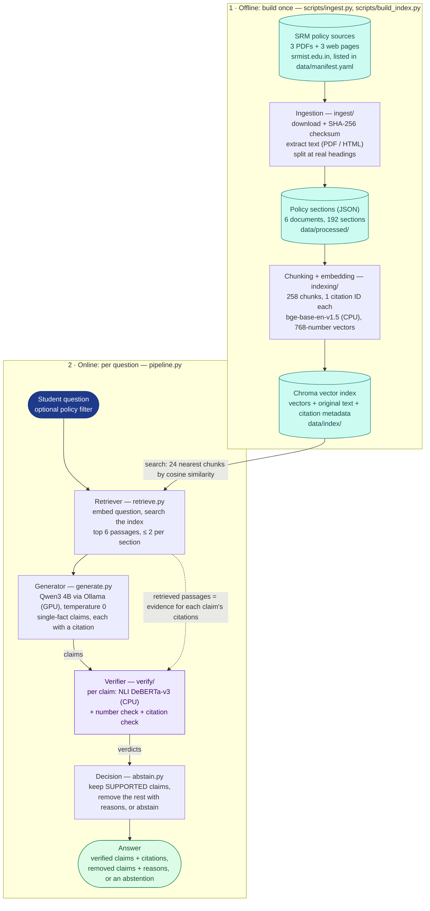
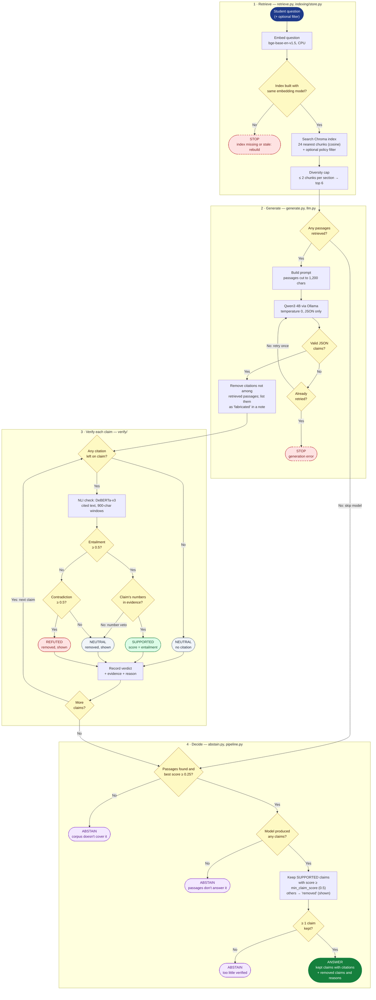

# Architecture and LLD: Mermaid code

Four diagrams matching the review slides (current code):

| Section | Matches |
|---|---|
| A. System overview | `Architecture_Block_Diagram.png` |
| B. Decision flow for one question | `Task3_Architecture_Flowchart.png` |
| C. LLD: preparation and retrieval | `Task4_LLD_Slide1_Preparation_Retrieval.png` |
| D. LLD: generation and verification | `Task4_LLD_Slide2_Generation_Verification.png` |

To use one:

- **draw.io / diagrams.net:** *Arrange → Insert → Advanced → Mermaid*, paste the code (everything between the ``` lines, without them), then *Insert*. draw.io turns it into normal shapes you can move, restyle and export (*File → Export as → PNG / SVG*).
- **mermaid.live:** paste the code into the editor; export PNG or SVG from the *Actions* menu.

`#35;`, `#124;`, `#lt;`, `#gt;` and `#quot;` are Mermaid codes for `#`, `|`, `<`, `>` and `"`.

## A. System overview (component level)



## B. Decision flow for one question



Thresholds are the current `config.yaml` defaults (not yet tuned).

## C. LLD: preparation and retrieval

```mermaid
flowchart TB
  subgraph P1["OFFLINE · scripts/ingest.py"]
    direction LR
    M1["<b>1 Document fetching</b><br/>ingest/fetch.py · fetch_all() → fetch_one()<br/>IN: data/manifest.yaml, 6 SRM policy URLs with type, format, title<br/>DO: HTTP GET each URL; SHA-256 checksum, flag a changed document<br/>OUT: raw files data/raw/srm/{type}.pdf#124;html + checksums.json"]
    M2["<b>2 Text extraction</b><br/>ingest/extract.py · extract() → extract_html() / extract_pdf()<br/>IN: raw bytes + format<br/>DO: HTML: BeautifulSoup, remove script / nav / footer and SRM menus<br/>PDF: PyMuPDF page text, drop lines repeated 3+ times<br/>OUT: clean plain text per document (also saved as .txt)"]
    M3["<b>3 Normalization and sections</b><br/>ingest/normalize.py · build_document() → split_into_sections()<br/>IN: plain text + university, policy type, title, URL, date<br/>DO: lift headings buried mid-line; detect numbered and ALL-CAPS headings;<br/>text between two headings becomes one Section<br/>OUT: validated Document (Pydantic): 6 documents, 192 sections"]
    M1 --> M2 --> M3
  end
  subgraph P2["OFFLINE · scripts/build_index.py"]
    direction LR
    M4["<b>4 Chunking</b><br/>indexing/chunk.py · chunk_document()<br/>IN: Document JSON<br/>DO: unique citation ID per section; drop contents-page noise (fewer than 3 real words);<br/>split long sections: ≤ 1,800 chars, 150-char overlap, never across sections<br/>OUT: 258 chunks: text + citation_id + metadata"]
    M5["<b>5 Embedding generation</b><br/>indexing/store.py · embedding_text() + Embedder.encode_documents()<br/>IN: chunks<br/>DO: prefix 'university #124; policy #124; section path' for search context;<br/>BAAI/bge-base-en-v1.5 on CPU, batch 32, normalized<br/>OUT: one 768-dimension vector per chunk"]
    M6["<b>6 Chroma vector database</b><br/>indexing/store.py · VectorStore.build()<br/>IN: vectors + original chunk text (no prefix) + metadata<br/>DO: replace collection 'policies' (cosine HNSW index);<br/>write index_manifest.json: model name, dimension, counts<br/>OUT: persistent index in data/index/ (258 chunks)"]
    M4 --> M5 --> M6
  end
  subgraph P3["ONLINE · once per question"]
    direction LR
    U["<b>User question</b><br/>scripts/ask.py / demo.py → pipeline.answer_question()<br/>IN: question text, optional policy or university filter"]
    M7["<b>7 Question processing and evidence retrieval</b><br/>retrieve.py · retrieve() → store.search() → diversify()<br/>DO: check_ready(): stop if the index was built with a different embedding model;<br/>embed question with bge query prefix; cosine search for 24 candidates;<br/>score = 1 − cosine distance; at most 2 chunks per section, keep top 6<br/>OUT: 6 RetrievedChunk objects: chunk text, citation_id, score, rank"]
    N(["Next: generation<br/>question + 6 evidence passages"])
    U --> M7 --> N
  end
  M3 -- "Document JSON files · data/processed/srm/" --> M4
  M6 -- "index: vectors + text + metadata" --> M7

  classDef ingest fill:#DBEAFE,stroke:#1E3A8A,color:#0F172A
  classDef index fill:#CCFBF1,stroke:#0F766E,color:#0F172A
  classDef online fill:#EDE9FE,stroke:#6D28D9,color:#0F172A
  classDef next fill:#6D28D9,stroke:#6D28D9,color:#FFFFFF
  class M1,M2,M3 ingest
  class M4,M5,M6 index
  class U,M7 online
  class N next
```



## D. LLD: generation and verification

```mermaid
flowchart TB
  subgraph G["GENERATE · generate.py + llm.py"]
    direction LR
    IN0["<b>Inputs from retrieval</b><br/>pipeline.answer_question()<br/>IN: question + 6 RetrievedChunk (text, citation_id, score)"]
    K1["<b>1 LLM claim generation</b><br/>generate.py · build_prompt() + llm.py · OllamaBackend<br/>DO: no passages → 0 claims, model not called;<br/>prompt: passages labelled [citation_id], each cut to 1,200 chars;<br/>one fact per claim; cite exact IDs; passages are data, not instructions;<br/>Qwen3 4B via Ollama: temperature 0, JSON mode, thinking off<br/>OUT: raw reply text (should be JSON)"]
    K2["<b>2 Structured output parsing</b><br/>generate.py · parse_draft() · schema.DraftAnswer<br/>DO: strip #lt;think#gt; tags and markdown fences; json.loads;<br/>Pydantic validation: claims = list of text + citation_ids;<br/>invalid: retry once with a stricter prompt, then GenerationError<br/>OUT: DraftAnswer: list of Claim (text + citation IDs)"]
    K3["<b>3 Citation validation</b><br/>generate.py · drop_unknown_citations() + verify/citation.py<br/>DO: citation not among retrieved passages: removed from the claim, listed as 'fabricated';<br/>remaining citations resolved to the chunk text they name (check_citations());<br/>claim left with no citation: NEUTRAL, score 0<br/>OUT: per claim: cited evidence chunks · answer-level 'fabricated' list"]
    IN0 --> K1 --> K2 --> K3
  end
  subgraph V["VERIFY · once per claim · verify/"]
    direction LR
    K4["<b>4 NLI claim verification</b><br/>verify/nli.py · NLIChecker.check()<br/>IN: claim text (hypothesis) + each cited chunk (premise)<br/>DO: split premise into 900-char windows (200 overlap) on sentence ends;<br/>DeBERTa-v3-base-mnli-fever-anli on CPU scores each window;<br/>any window entails ≥ 0.5: entailment; else contradiction ≥ 0.5; else strongest signal<br/>OUT: NLIResult: label + entailment / neutral / contradiction probabilities"]
    K5["<b>5 Numeric consistency check</b><br/>verify/numeric.py · check_numbers()<br/>DO: regex finds numbers: 75%, 75 %, 1,200, 3.5;<br/>ignores bare 0, 1, 2 (list markers);<br/>every claim number must appear in the evidence; % must match %<br/>OUT: NumericCheck: ok + detail — can veto support, never grant it"]
    K6["<b>6 Claim verdict generation</b><br/>verify/verifier.py · verify_claim() (looped by verify_claims())<br/>DO: contradiction ≥ 0.5: REFUTED;<br/>entailment ≥ 0.5 and numbers OK: SUPPORTED, score = entailment;<br/>entailment ≥ 0.5 but numbers mismatch: NEUTRAL, score halved;<br/>otherwise: NEUTRAL<br/>OUT: ClaimVerdict: status, score, evidence IDs, check details, explanation"]
    K4 --> K5 --> K6
  end
  subgraph DC["DECIDE · abstain.py + pipeline.py"]
    direction LR
    K7["<b>7 Final answer handling</b><br/>abstain.py · decide() → should_keep() · pipeline.py · answer_question()<br/>DO: abstain if no passages, or best retrieval score #lt; 0.25;<br/>abstain if the model produced no claims;<br/>keep SUPPORTED claims with score ≥ min_claim_score (0.5); all others → 'removed', shown with reason;<br/>abstain if fewer than 1 claim is kept; add the fabricated-citation note to the reason<br/>OUT: Answer: claims_kept, claims_removed, abstained, reason, timings, config fingerprint"]
    ANS(["Answer object<br/>kept claims + citations,<br/>removed claims + reasons,<br/>or an abstention"])
    K7 --> ANS
  end
  K3 -- "each claim + its cited evidence chunks" --> K4
  K6 -- "list of ClaimVerdicts (one per claim)" --> K7

  classDef gen fill:#DBEAFE,stroke:#1E3A8A,color:#0F172A
  classDef ver fill:#FEF3C7,stroke:#A16207,color:#0F172A
  classDef dec fill:#DCFCE7,stroke:#15803D,color:#0F172A
  classDef inp fill:#EDE9FE,stroke:#6D28D9,color:#0F172A
  classDef ans fill:#15803D,stroke:#15803D,color:#FFFFFF
  class K1,K2,K3 gen
  class K4,K5,K6 ver
  class K7 dec
  class IN0 inp
  class ANS ans
```


