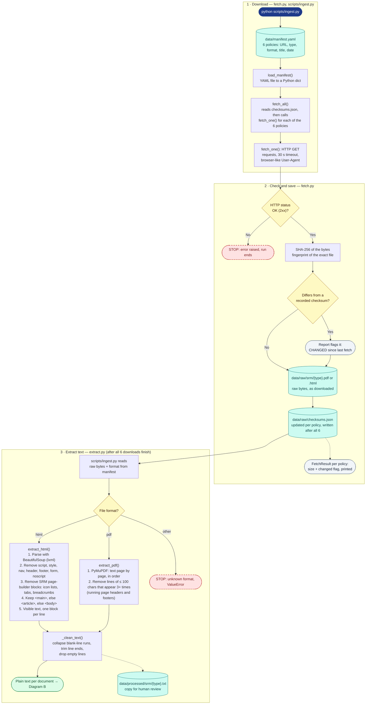
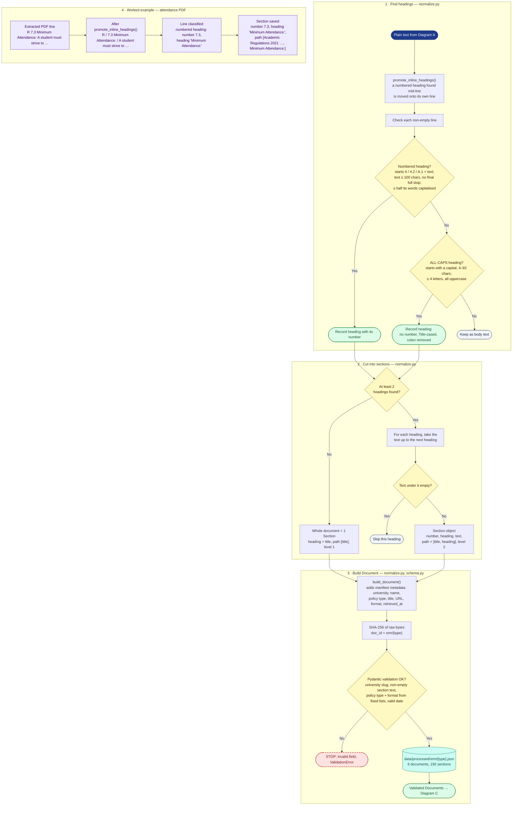

# Preparation-phase LLD: Mermaid code

Three diagrams matching `Prep_LLD_A/B/C` (current code). To use one:

- **draw.io / diagrams.net:** *Arrange → Insert → Advanced → Mermaid*, paste the code (everything between the ``` lines, without them), then *Insert*.
- **mermaid.live:** paste the code into the editor; export PNG/SVG from the *Actions* menu.

`#35;`, `#124;`, `#lt;` and `#gt;` are Mermaid codes for `#`, `|`, `<` and `>`.

## A. Corpus preparation (fetch.py, extract.py, scripts/ingest.py)



## B. Document processing (normalize.py, schema.py)



## C. Chunking and indexing (chunk.py, store.py, scripts/build_index.py)

```mermaid
flowchart TB
  subgraph L1["1 · Load and cite — scripts/build_index.py, schema.py"]
    G0(["python scripts/build_index.py"]) --> G1[("data/processed/srm/*.json<br/>6 Document files")]
    G1 --> G2["load_documents()<br/>re-validates each file against the schema"]
    G2 --> G3["Document.citations()<br/>key = '{number}-{heading slug}'<br/>slug: lowercase, other chars → _, max 40;<br/>no number → slug only"]
    G3 --> G4{"Key already used<br/>in this document?"}
    G4 -- Yes --> G5["Append -2, -3, …<br/>e.g. consequence-2"]
    G4 -- No --> G6(["Citation ID<br/>srm/attendance/7.3-minimum_attendance"])
    G5 --> G6
  end
  subgraph L2["2 · Chunk — chunk.py"]
    H1["For each section<br/>with its citation ID"] --> H2{"Fewer than 3 real words?<br/>(real word = 2+ letters)"}
    H2 -- Yes --> H3(["Drop: contents-page entry<br/>e.g. 'Payment Of Fine' → 12"])
    H2 -- No --> H4{"≤ 1,800 characters?"}
    H4 -- Yes --> H5["One chunk = the whole section"]
    H4 -- No --> H6["split_long_text()<br/>1. Split at blank lines, then sentence ends;<br/>hard-cut any piece still over 1,800 chars<br/>2. Pack pieces into windows of ≤ 1,800 chars<br/>3. Start each window with the last ~150 chars<br/>of the one before (from a word start)"]
    H5 --> H7["Chunk object<br/>chunk_id = '{citation ID}#35;0', '#35;1', …<br/>text, citation_id, university, name,<br/>policy type, section path, URL<br/>(258 chunks from 192 sections)"]
    H6 --> H7
  end
  subgraph L3["3 · Embed — store.py"]
    I1{"Any chunks at all?"} -- No --> I2(["STOP: refuse to build from zero"])
    I1 -- Yes --> I3["Delete the old 'policies' collection<br/>(full rebuild, no leftovers)"]
    I3 --> I4["embedding_text()<br/>'{university name} #124; {policy type} #124; {section path}'<br/>+ new line + chunk text (prefix used for search only)"]
    I4 --> I5["Embedder.encode_documents()<br/>BAAI/bge-base-en-v1.5 on CPU, batch 32,<br/>normalised → one 768-number vector per chunk"]
  end
  subgraph L4["4 · Store and check — store.py, scripts/build_index.py"]
    J1["collection.add()<br/>id = chunk_id; document = ORIGINAL chunk text;<br/>embedding = vector; cosine-similarity HNSW index"]
    J1 -.-> J2(["metadata: chunk_id, citation_id, university,<br/>university_name, policy_type, section_path, source_url"])
    J1 --> J3[("data/index/<br/>Chroma database, 258 chunks, 768 dims")]
    J3 --> J4[("index_manifest.json<br/>model name, dims, chunk + doc counts,<br/>built_at, chunking (checked before every search)")]
    J4 --> J5{"--no-test flag given?"}
    J5 -- No --> J6["Smoke test<br/>3 sample questions, top 3 each"]
    J5 -- Yes --> J7(["Index ready<br/>searched at question time"])
    J6 --> J7
  end
  G6 --> H1
  H7 --> I1
  I5 --> J1

  classDef start fill:#1E3A8A,stroke:#1E3A8A,color:#FFFFFF
  classDef file fill:#CCFBF1,stroke:#0F766E,color:#134E4A
  classDef stop fill:#FEE2E2,stroke:#B91C1C,color:#7F1D1D,stroke-dasharray:5 5
  classDef note fill:#F1F5F9,stroke:#64748B,color:#1E293B
  classDef good fill:#DCFCE7,stroke:#15803D,color:#14532D
  classDef decision fill:#FEF9C3,stroke:#A16207,color:#422006
  class G0 start
  class G1,J3,J4 file
  class I2 stop
  class H3,J2 note
  class G6,J7 good
  class G4,H2,H4,I1,J5 decision
```


